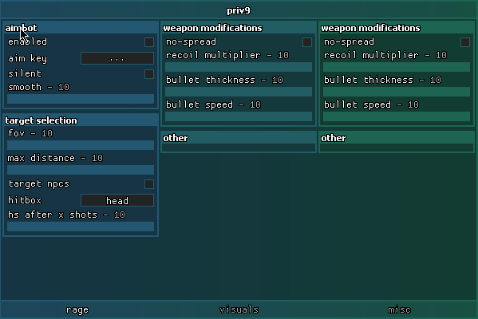

*note really really old(~3y) unsure if it even works*

**Preview**


 

**Loading the Library**

```lua
local library, notifications = loadstring(game:HttpGet("https://raw.githubusercontent.com/0x340/Priv9-Interface/blob/main/src/Library.lua"))()
```

**Window**
```lua
local window = library:window({
  name = <sting> -- window name
})
```

**Notifications**
```lua
notifications:create_notification({
  name = <string> --// notification text
})
```


**Tabs**
```lua
local tab = window:tab({
  name = <string> --// tab names
})
```


**Columns**
```lua
local column = tab:column({})
```


**Sections**
```lua
local section = column:section({
  name = <string>,
  auto_fill = <boolean>,
  size = <number>,

  callback = function()
})
```


**Checkbox**
```lua
section:toggle({
  name = <string>,
  flag = <string>,

  callback = function()
})
```

**Keybind**
```lua
section:keybind({
  name = <string>,

  callback = function()
})
```


**Sliders**
```lua
section:slider({
  name = <string>,
  min = <number>,
  max = <number>,
  default = <number>,
  interval = <number>,
  suffix = <string>,

  callback = function()
})
```


**Combo**
```lua
section:dropdown({
  name = <string>,
  flag = <string>,
  items = {<string>, <string>},
  default = <string>,

  callback = function()
})
```


## ColorPicker
```lua
section:colorpicker({
  name = <string>,
  color = Color3.fromRGB(255, 0, 0),
  alpha = <value>,
  flag = "color_picker",

  callback = function()
})
```


**Button**
```lua
section:button({
  name = <string>,

  callback = <function>
})
```


**Config**
```lua
library:init_config(window)
```
